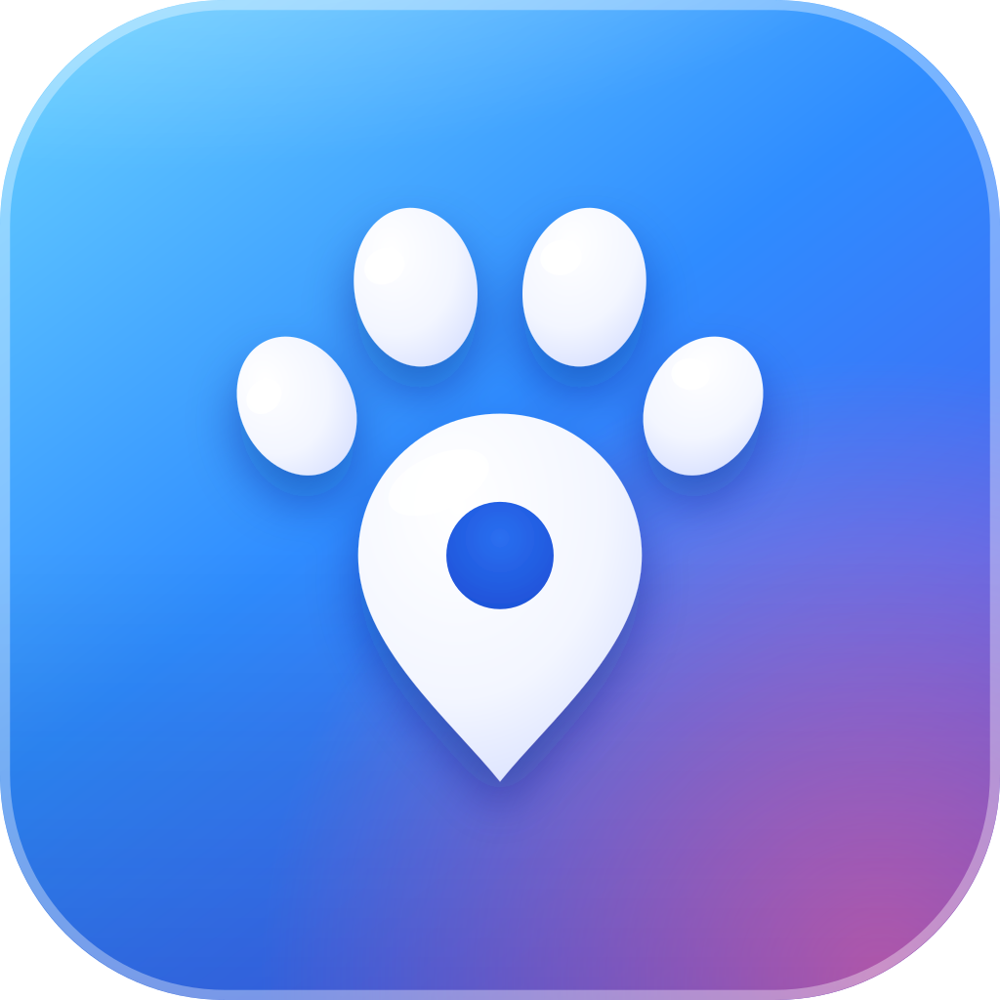
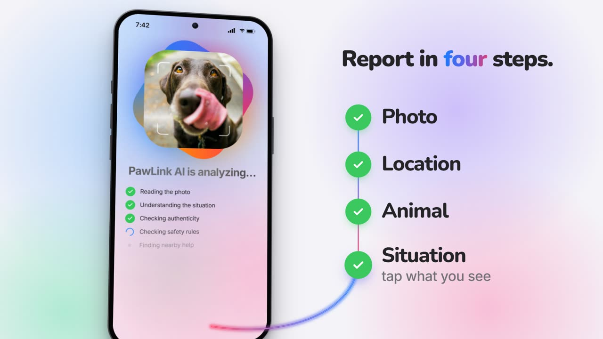
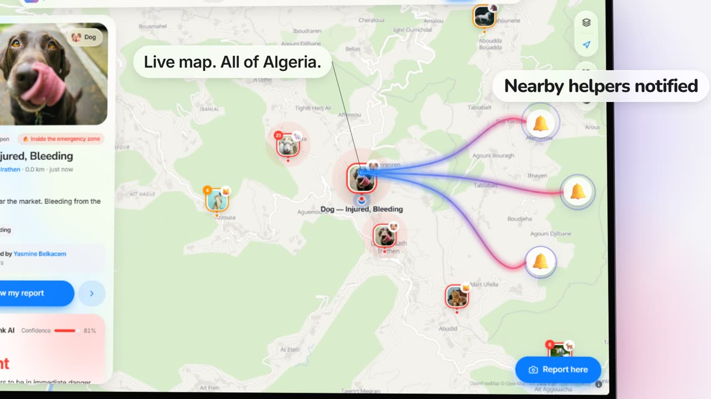
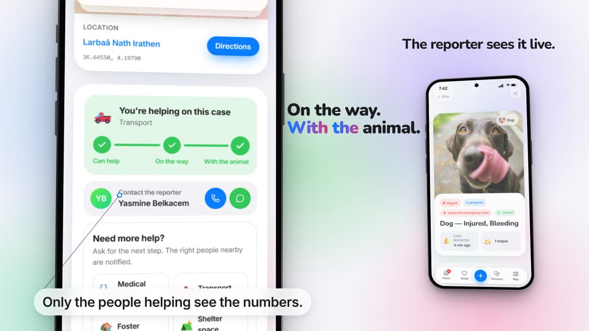
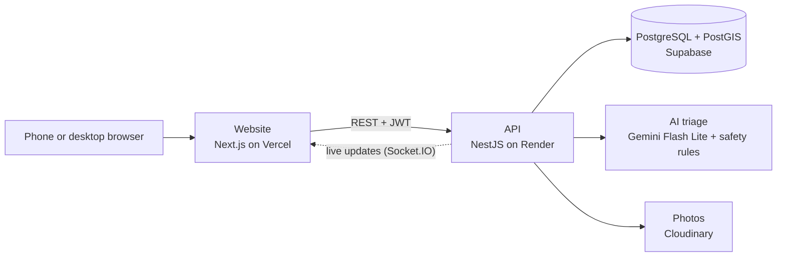

<p align="center">
  
</p>

<h1 align="center">PawLink</h1>

<p align="center"><b>Every animal, one link away.</b><br>A rescue platform for Algeria: report a hurt or lost animal, get an AI triage, and reach the nearest volunteers and vets in minutes.</p>

<p align="center">
  <a href="https://pawlink-iota.vercel.app"><b>Live app</b></a> ·
  <a href="https://github.com/Maelryn/PAWLINK/releases/latest/download/pawlink.apk"><b>Android app</b></a> ·
  <a href="https://drive.google.com/file/d/1JANE4jCT9YgheHL4IAcskFwOXm4EmO8z/view"><b>Demo video</b></a> ·
  <a href="https://drive.google.com/file/d/1WC53C9OgbtyxWyT-iHZMfOamC5YnKotO/view"><b>Pitch deck</b></a> ·
  <a href="https://pawlink-backend.onrender.com/docs"><b>API docs</b></a>
</p>

<p align="center">
  
  
  
</p>

**In Algeria, people who find an injured or lost animal don't know who to call. PawLink connects them in minutes with nearby volunteers and vets.**

You report the animal with a photo and its position. An AI triage says how urgent it is and what to do right now (never a diagnosis, always "see a vet"). The case appears on a live map of Algeria, the nearest available helpers are told, one of them taps "I can help", goes on the way, reaches the animal and can ask for more help (a vet, transport, a foster family) until the animal is safe.

Built in Algeria by a team of seven students during the Thirduni programme (October 2026).

| | |
|---|---|
| **Live app** | https://pawlink-iota.vercel.app |
| **Android app** (APK) | https://github.com/Maelryn/PAWLINK/releases/latest/download/pawlink.apk |
| **API** (+ Swagger docs) | https://pawlink-backend.onrender.com · [/docs](https://pawlink-backend.onrender.com/docs) · [/health](https://pawlink-backend.onrender.com/health) |
| **Demo video** (3 min) | https://drive.google.com/file/d/1JANE4jCT9YgheHL4IAcskFwOXm4EmO8z/view |
| **Pitch deck** (PDF) | https://drive.google.com/file/d/1WC53C9OgbtyxWyT-iHZMfOamC5YnKotO/view |

---

## Try it in 2 minutes

Open the live app and sign in with a demo account (password `pawlink2026` for all of them):

| Account | Role | Try this |
|---|---|---|
| `yasmine@pawlink.dz` | reporter | Hold the **+** button → "Report an animal", answer the AI's question, see your case on the map |
| `amine@pawlink.dz` | volunteer | Open a case → "I can help" → "I'm on the way" → "I'm with the animal" → "Need more help?" |
| `dr.taleb@pawlink.dz` | vet with PawLink Pro | Home shows the Pro card; the Pro tab has appointments and reviews |
| `ines@pawlink.dz` | admin | Admin: moderation queues, emergency zones, users |

Reporting needs your location in Algeria. If location is blocked, use "Use the demo position": the report is then marked "not on site" and can't count as verified. The live app runs on the website's built-in demo data, so every role can be tried instantly and nothing you do reaches other people. The API runs separately on Render: its endpoints can be tried in the [Swagger docs](https://pawlink-backend.onrender.com/docs).

## What it does

| Area | What works |
|---|---|
| **Report** | Photo, position (in Algeria, within 2 km of the animal), animal, situation. Works on phone and desktop |
| **AI triage** | Gemini Flash Lite rates the case urgent / to watch / stable, gives first-aid tips and the help needed, and asks a quick question when something important is missing. Understands French, English, Arabic and Algerian Darija. Safety rules can only raise the urgency. A fallback answers if the model is slow or down |
| **Live map** | Every case of Algeria with filters, 3D, a layers bar (all cases / my reports / services) and an **emergency mode** for wildfires and floods |
| **Rescue workflow** | Nearby available helpers are notified → "I can help" → on the way → with the animal → ask for the next help → resolved. The reporter follows it live; only the reporter and the helpers see each other's phone number |
| **Trust** | Algeria only, 2 km rule, real camera photo (EXIF), duplicate photo check, rate limit, people within 1 km confirm "Do you see this animal?" (two yes = verified), admin moderation |
| **Adoption** | Listings with real photos and admin approval, requests, phone numbers shared only after "yes", "It's adopted" |
| **Vets & services** | Directory near you, reviews, appointment requests, PawLink Pro listing for businesses |
| **Community** | Public profiles with earned badges (trusted helper, verified vet), 3-level availability |
| **For Algeria** | العربية (right to left) · Français · English, light and dark mode |

## How it's built



| Part | Folder | Stack |
|---|---|---|
| Website | [`apps/web`](apps/web) | Next.js 16, React 19, TypeScript, Tailwind CSS v4, Motion, MapLibre GL + OpenFreeMap / OpenStreetMap, exifr |
| API | [`apps/backend`](apps/backend) | NestJS 11, Prisma 7, PostgreSQL + PostGIS (Supabase), JWT + refresh tokens, argon2, Socket.IO, Swagger, Jest |
| AI triage | [`apps/backend/src/ai`](apps/backend/src/ai) (in the API) · [`apps/Ai`](apps/Ai) (standalone module + 35-case test suite) | Google Gemini Flash Lite (`@google/genai`), Zod, keyword safety rules in 4 languages, cached fallbacks |
| Mobile app | branch [`flutter-mobile`](https://github.com/Maelryn/PAWLINK/tree/flutter-mobile) · [download the APK](https://github.com/Maelryn/PAWLINK/releases/latest/download/pawlink.apk) | Flutter, designed in Figma: home, adoption, services, live map and the report flow. Runs on sample data for now; the API connection is next |
| Hosting | | Vercel (website), Render (API, kept awake by a [GitHub Action](.github/workflows)), Supabase (database), Cloudinary (photos) |

**AI tools used to build PawLink:** Claude Code (Anthropic) for code, design, docs, the demo video and the pitch deck; ChatGPT for brainstorming and prompt drafts; Devin for verifying the AI module. Everything AI-made was reviewed and tested by the team.

## Run it locally

You need Node 20+.

**Website** (works on its own with built-in demo data):

```bash
cd apps/web
npm install
npm run dev
```

Open http://localhost:3000. To use a local API instead of the demo data, copy `apps/web/.env.example` to `.env.local` and set `NEXT_PUBLIC_API_URL=http://localhost:4000` and `NEXT_PUBLIC_API_FEATURES=auth,cases,uploads,ai,adoptions,services,notifications,admin`.

**API** (needs a PostgreSQL + PostGIS database, e.g. a free Supabase project):

```bash
cd apps/backend
npm install
cp .env.example .env      # your database URLs; GEMINI_API_KEY is optional (without it the AI uses its fallback)
npm run prisma:deploy
npm run seed
npm run dev               # http://localhost:4000, Swagger at /docs
```

Tests: `npm test` (unit) and `npm run test:e2e` (needs the database). Details in [`apps/backend/README.md`](apps/backend/README.md).

No secrets are committed: every `.env*` file is git-ignored, and each app has a `.env.example`.

## Repository map

```
apps/
  web/        website (Next.js): every screen, the demo data layer, the API client
  backend/    API (NestJS): accounts, cases, trust checks, AI triage, adoption, services, zones, admin
  Ai/         AI triage module and its 35-case evaluation, as built and tested on its own
  mobile/     early Expo starter; the Flutter app (v1.0, APK released) lives on the flutter-mobile branch
brand/        logo and app icon, light and dark
docs/
  research/   facts with sources, interviews
  tasks/      how the work was split, per person
  *.md        the backend and mobile plans, prompts and audits written while building
.github/      the GitHub Action that keeps the API awake
```

## What's next

In the next three months: launch in Algiers and Tizi Ouzou with local rescue associations, connect the Android app to the API and publish it on Google Play, and bring the first vets and pet shops onto PawLink Pro (2,900 DA a month) to cover the servers. Rescuers will always use PawLink for free. We will measure how quickly a reported animal gets help, and improve the AI with real cases reviewed by vets.

## Sources

Every number we use is listed with its source in [`docs/research/facts.md`](docs/research/facts.md).
