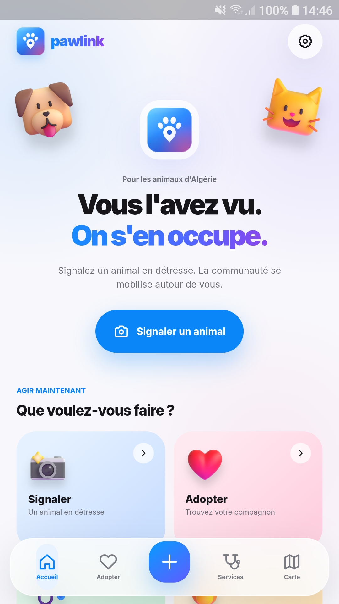
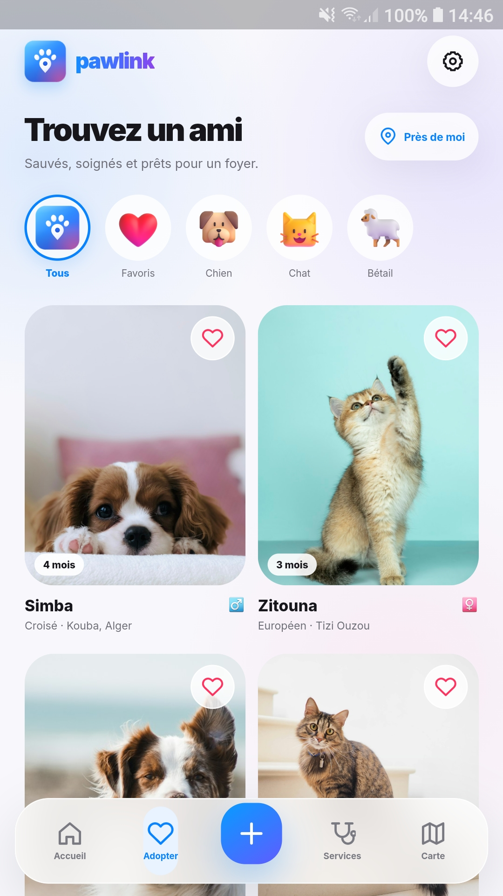
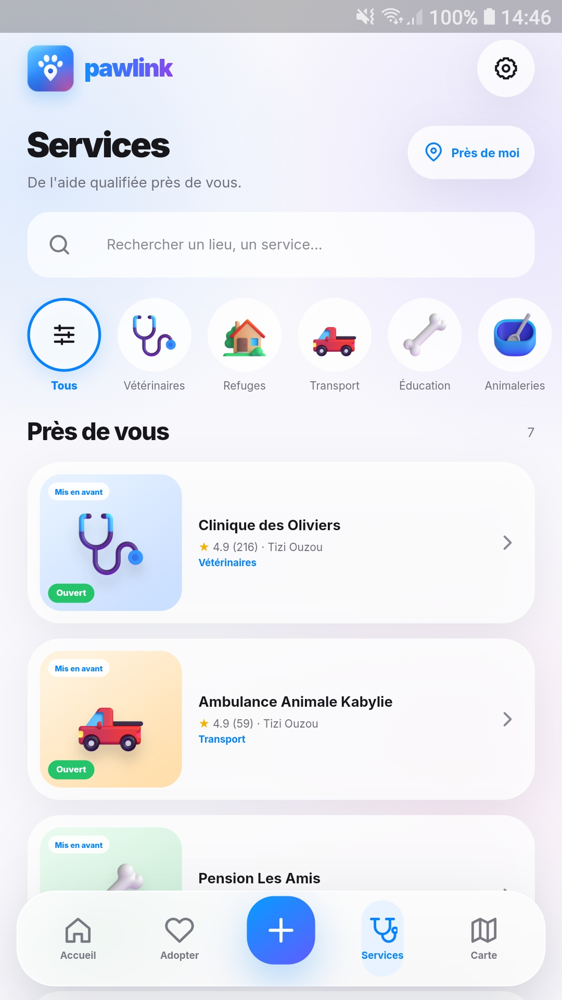
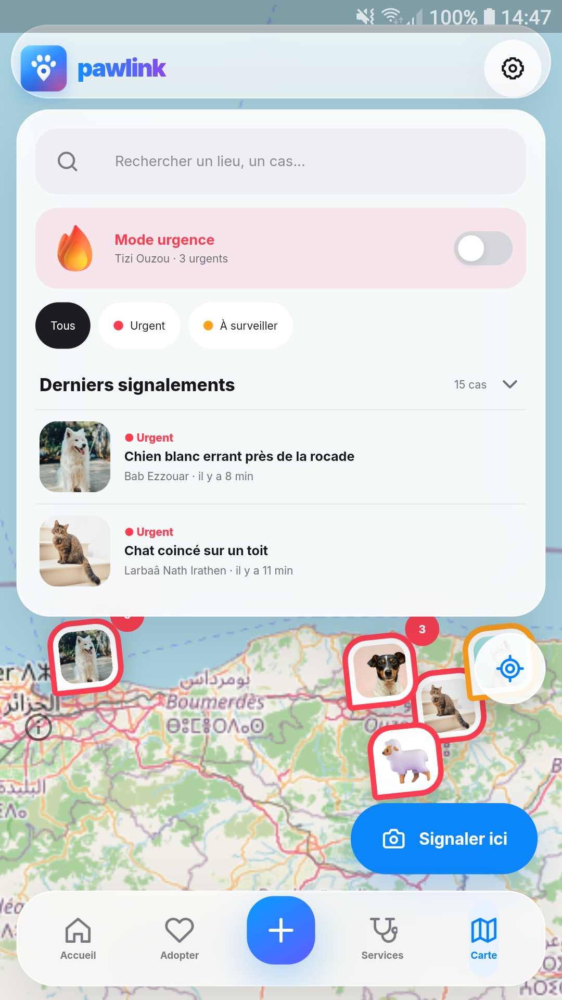
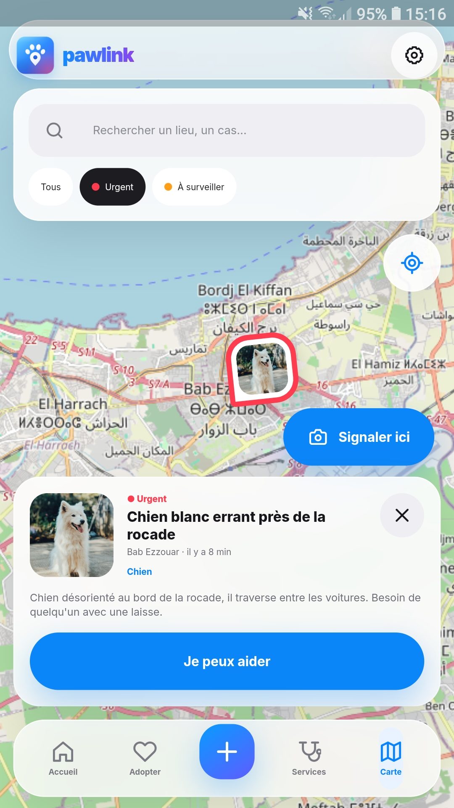
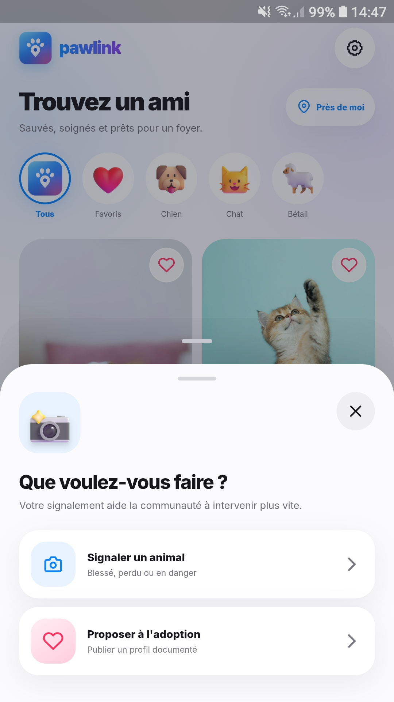

# PawLink – Mobile app (Flutter)

The native Android/iOS app of **PawLink**: report an injured or lost animal in Algeria, adopt a rescued pet, and find vets, shelters and pet services near you.

This folder contains only the mobile app. For the full project (website, API, AI) see the [main README](../../README.md).

## Screenshots

<table>
  <tr>
    <td align="center"><br><b>Accueil</b></td>
    <td align="center"><br><b>Adopter</b></td>
    <td align="center"><br><b>Services</b></td>
  </tr>
    <tr>
    <td align="center"><br><b>Carte</b></td>
    <td align="center"><br><b>Cas · « Je peux aider »</b></td>
    <td align="center"><br><b>Menu « + »</b></td>
  </tr>
</table>

## What works today

| Screen | Status |
|---|---|
| **Accueil**: hero, quick actions, live cases nearby | ✅ |
| **Adopter**: list with filters (Tous, Favoris, Chien, Chat, Bétail), favourites, animal detail with photo gallery, adoption request (phone shown only once the owner accepts) | ✅ |
| **Services**: directory of vets, shelters, transport, training and pet shops with search and filters; place detail with reviews and appointment requests (Pro places) | ✅ |
| **Carte**: live map of cases (OpenStreetMap, clustering, urgency colors), emergency mode, search, case preview with "Je peux aider" | ✅ |
| **Signaler**: "+" sheet, report in 4 steps (photo, position in Algeria, animal, situation), follow-up questions, triage result; the new case appears on the map | ✅ |
| Light and dark mode (follows the phone) | ✅ |
| French interface | ✅ · Arabic (right-to-left) and English planned |

**Honest note:** the app currently runs on **sample data** stored in the app (fake repositories in `lib/features/*/data/`). Each repository sits behind an interface that mirrors the website's data types (`apps/web/lib/types.ts`), so connecting the real API (`apps/backend`) means replacing the fake repository, not the screens.

**Triage on mobile** uses the website's safety-rule layer only (danger words always force "urgent", never a diagnosis, always "see a vet"). The Gemini model runs on the website and backend; mobile will call it once the API is connected.

## Run it

### Install the app (Android)

**[⬇ Download pawlink.apk](https://github.com/Maelryn/PAWLINK/releases/latest/download/pawlink.apk)**

Open the file on an Android phone (6.0 or newer) and allow "Install unknown apps" when asked. The app runs on sample data, so no account is needed.

To build it yourself instead, follow the steps below.

### Requirements

- Flutter **3.29+** (stable channel), Dart 3
- Android Studio with:
  - Android SDK Platform **36**
  - NDK **27.0.12077973** (SDK Manager → SDK Tools → Show Package Details)
  - JDK 17 (bundled with Android Studio)
- An Android phone with USB debugging enabled, or an Android emulator (Android 6.0 / API 23 or newer)

Check your setup with:

```bash
flutter doctor
```

### Steps

```bash
git clone https://github.com/Maelryn/PAWLINK.git
cd PAWLINK
git checkout flutter-mobile
cd apps/mobile
flutter pub get
flutter run
```

`flutter run` builds the app and installs it on the connected phone or emulator. The first build takes a few minutes.

### Build an APK

```bash
flutter build apk --release
```

The file is created at `build/app/outputs/flutter-apk/app-release.apk`. Copy it to an Android phone, open it, and allow installing from unknown sources.

### Tests

```bash
flutter analyze
flutter test
```

## How it's built

| Part | Choice |
|---|---|
| Framework | Flutter, Material 3 |
| State management | Riverpod |
| Navigation | go_router (bottom tabs with `StatefulShellRoute`) |
| HTTP (for the API) | dio |
| Map | flutter_map + OpenStreetMap tiles, flutter_map_marker_cluster |
| Location / camera | geolocator, image_picker |
| Icons and images | flutter_svg |
| Design source | Figma Make file of the PawLink mobile design |

```
lib/
  core/       theme (colors, text styles, spacing), router, map settings
  shared/     reusable widgets (bottom nav, "+" sheet, buttons, cards, background)
  features/
    home/       Accueil
    adopt/      Adopter: list, detail, request
    services/   Services: directory, detail, reviews, appointments
    cases/      shared case data, used by Carte, Signaler and Accueil
    map/        Carte
    report/     Signaler: steps, triage rules, result
```

Each feature has `data/` (models, repository interface, fake repository), `presentation/` (screens and widgets) and `providers.dart`.

## Credits and licenses

- Fonts: [Inter](https://rsms.me/inter/) and [IBM Plex Sans Arabic](https://github.com/IBM/plex), SIL Open Font License (`assets/fonts/`)
- Icons: Make design icons, plus [Lucide](https://lucide.dev) icons under the ISC license (`assets/icons/LICENSE-lucide.txt`)
- Map data: © [OpenStreetMap](https://www.openstreetmap.org/copyright) contributors
- Illustrations: [source, to confirm with the design team]
- Sample animal photos: from the website's demo data (`apps/web/public/mock`)